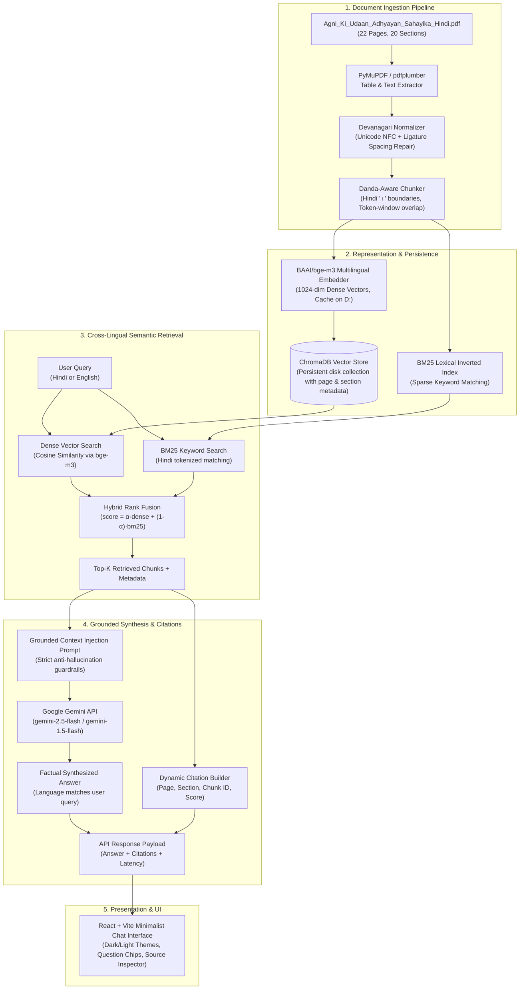

# Architecture Documentation — Cross-Lingual Hindi RAG Engine

## 1. Overview & Architecture Diagram

## 2. Core Architectural Principles

1. **Cross-Lingual Projection:** English questions and Hindi passages are projected into a common semantic space via `BAAI/bge-m3`.
2. **Deterministic Source Traceability:** Every response is anchored by metadata extracted during ingestion (`page`, `section`, `chunk_id`, `score`).
3. **Linguistic Sensitivity:** Hindi sentence segmentation respects the Hindi Danda (`।` - `U+0964`) and handles ligature spacing anomalies specific to Devanagari PDF typography.
4. **Resilient Hardware Footprint:** High-capacity secondary storage (`D:\`) handles model weights, HuggingFace caches (`HF_HOME`), and PyTorch checkpoints, preventing host system drive exhaustion.
